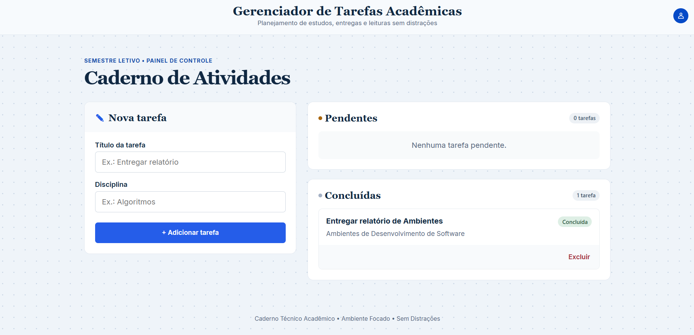

# Gerenciador de Tarefas Acadêmicas

Projeto da disciplina **Ambientes de Desenvolvimento de Software** (bloco *Full Stack App*).
Um único projeto para demonstrar seis ambientes: Trello, Google Stitch, Visual Studio Code,
SQLite + DB Browser for SQLite, Selenium e Node.js + Express.

Funcionalidades: cadastrar tarefa (título + disciplina, começa como **Pendente**), listar, editar,
marcar como **Concluída** e excluir. Os dados ficam salvos em SQLite e continuam depois de
atualizar a página ou reiniciar o servidor.

O servidor aceita apenas título e disciplina em formato de texto, com até 120 e 80 caracteres,
respectivamente. Durante o salvamento, o formulário bloqueia novos envios para evitar duplicações.

## Evidências do projeto

O fluxo demonstrado é o de uma tarefa acadêmica criada no navegador, editada e marcada como concluída. O frontend envia as operações à API Express, que grava os dados no SQLite.

| Ambiente | Evidência | O que aparece na captura |
|---|---|---|
| Gestão da equipe · Trello | [Abrir quadro no Trello](https://trello.com/b/0D6Wm1NP/gerenciador-de-tarefas-academicas) · [Captura do quadro](docs/evidencias/trello.png) | Distribuição das atividades entre as listas durante o desenvolvimento. |
| Design de interfaces · Google Stitch | [Nova tarefa](docs/evidencias/stitch-cadastro.png) · [Editar tarefa](docs/evidencias/stitch-edicao.png) | O formulário alterna entre cadastro e edição, com as listas à direita. |
| Desenvolvimento · VS Code | [Projeto aberto no editor](docs/evidencias/vscode.png) | Pastas do frontend, banco, rotas e teste automatizado. |
| Execução · Node.js e Express | [Servidor no terminal](docs/evidencias/servidor.png) · [Aplicação em funcionamento](docs/evidencias/aplicacao.png) | O terminal registra requisições GET e a interface exibe o relatório em Concluídas. |
| Banco · SQLite e DB Browser | [Tabela de tarefas](docs/evidencias/sqlite.png) | A linha de ID 1 contém o título “Entregar relatório de Ambientes”, o mesmo exibido na aplicação. |
| Testes · Selenium | [Resultado no terminal](docs/evidencias/selenium.png) | Registro da execução no terminal. O fluxo coberto pelo teste está descrito nas instruções abaixo. |



## Pré-requisitos (Windows)

- [Node.js LTS](https://nodejs.org) (versão 22 ou 24). Confira no terminal: `node -v` e `npm -v`.
- Google Chrome (ou Microsoft Edge) para o teste Selenium.
- Visual Studio Code e DB Browser for SQLite.
- Internet na primeira vez (instalação dos pacotes e download automático do driver do navegador).

## Como executar

Abra a pasta do projeto no VS Code (**Arquivo > Abrir Pasta...**) e use **Terminal > Novo Terminal**.

### Terminal 1: servidor (este terminal fica aberto enquanto você usa o app)

```powershell
npm install
npm start
```

Saída esperada:

```text
Servidor rodando em http://localhost:3000
Banco de dados: C:\...\gerenciador-tarefas-academicas\data\tarefas.db
```

Abra **http://localhost:3000** no navegador. Para parar o servidor: `Ctrl + C`.
Para reiniciar (e provar que os dados persistem): `Ctrl + C` e depois `npm start` de novo.

### Terminal 2: teste automatizado (só com o Terminal 1 rodando)

Clique no **+** do painel Terminal do VS Code para abrir um segundo terminal e execute:

```powershell
npm test
```

O Chrome abre sozinho e executa o seguinte fluxo com uma tarefa de teste:

1. Cadastra a tarefa e confere o status **Pendente**.
2. Edita título e disciplina, atualiza a página e confere os valores alterados.
3. Conclui a tarefa e confere sua presença na lista **Concluídas**.
4. Atualiza a página e confere que o status **Concluída** foi mantido.
5. Exclui a tarefa, atualiza a página e confere que ela não reapareceu nas listas.

O terminal informa cada etapa aprovada. Ao terminar, o navegador fecha. Salve uma captura
do resultado desta execução em `docs/evidencias/selenium.png` para manter a evidência atualizada.

- **Passou:** o terminal mostra `TESTE PASSOU: ...` e o código de saída é 0
  (`echo $LASTEXITCODE` no PowerShell, `echo %ERRORLEVEL%` no CMD).
- **Falhou:** o terminal mostra `TESTE FALHOU: <motivo>` e o código de saída é 1.
  Motivos comuns: servidor desligado, Chrome não instalado ou sem internet na 1ª execução.
- Para usar o Edge: `$env:NAVEGADOR="edge"; npm test` (PowerShell) ou `set NAVEGADOR=edge && npm test` (CMD).

### Se o PowerShell bloquear o npm (erro com `npm.ps1`)

Use `npm.cmd` no lugar de `npm` (ou abra um terminal Command Prompt):

```powershell
npm.cmd install
npm.cmd start      # Terminal 1
npm.cmd test       # Terminal 2
```

## Estrutura do projeto

```text
gerenciador-tarefas-academicas/
├── package.json            # dependências e scripts (start, test)
├── server.js               # inicia o Express e registra as rotas
├── routes/
│   └── tarefas.js          # rotas da API (/api/tarefas)
├── database/
│   ├── database.js         # abre/cria o SQLite
│   └── schema.sql          # CREATE TABLE tarefas
├── public/
│   ├── index.html          # interface
│   ├── style.css
│   └── app.js              # chama a API e desenha as listas
├── tests/
│   └── selenium.test.js    # teste automatizado
└── data/
    └── tarefas.db          # criado automaticamente na 1ª execução
```

## Visual Studio Code: o que mostrar

| Para explicar | Abra |
|---|---|
| A interface | `public/index.html` (campos e botões) e `public/app.js` (comportamento) |
| As rotas da API | `server.js` e `routes/tarefas.js` |
| O acesso ao banco | `database/schema.sql` e `database/database.js` |

## API

| Método | Rota | O que faz |
|---|---|---|
| GET | `/api/tarefas` | Lista as tarefas |
| POST | `/api/tarefas` | Cadastra (`{"titulo": "...", "disciplina": "..."}`), status inicial `Pendente` |
| PUT | `/api/tarefas/:id` | Edita título e disciplina |
| PATCH | `/api/tarefas/:id/concluir` | Muda o status para `Concluída` |
| DELETE | `/api/tarefas/:id` | Exclui |

## Banco de dados (SQLite)

- **Arquivo:** `data/tarefas.db`, dentro da pasta do projeto. É criado automaticamente na primeira
  execução (o servidor também imprime o caminho completo ao iniciar).
- **Tabela `tarefas`:** `id`, `titulo`, `disciplina`, `status` (`Pendente` ou `Concluída`) e `criada_em`
  (esquema completo em `database/schema.sql`).

### Abrir no DB Browser for SQLite

1. Abra o DB Browser for SQLite e use **File > Open Database Read Only...** (somente leitura, para não
   travar o arquivo enquanto o servidor roda).
2. Selecione `data\tarefas.db` (se o arquivo não aparecer, mude o filtro para *All files*).
3. Aba **Browse Data**, tabela **tarefas**: localize a linha da tarefa cadastrada no navegador.
   Depois de cadastrar ou concluir algo no site, atualize a visualização (botão de atualizar ou `F5`).
4. Aba **Execute SQL**: cole a consulta abaixo e execute (botão ▶ ou `Ctrl + Enter`).

```sql
SELECT id, titulo, disciplina, status
FROM tarefas
WHERE titulo = 'Entregar relatório de Ambientes';
```

Para ver as últimas tarefas, qualquer uma:

```sql
SELECT id, titulo, disciplina, status FROM tarefas ORDER BY id DESC LIMIT 10;
```

## Caminho completo do cadastro (Node.js + Express)

1. **Formulário:** o usuário preenche "Título da tarefa" e "Disciplina" e clica em "Adicionar tarefa"
   (`public/index.html`).
2. **Frontend:** `public/app.js` captura o envio e faz `POST /api/tarefas` com o JSON
   `{"titulo": "...", "disciplina": "..."}`.
3. **Express:** `server.js` lê o JSON (`express.json()`), registra `[API] POST /api/tarefas` no terminal
   e entrega a requisição a `routes/tarefas.js`, que valida os campos.
4. **SQLite:** a rota executa `INSERT INTO tarefas (titulo, disciplina) VALUES (?, ?)` (arquivo
   `data/tarefas.db`). O status nasce `Pendente` pelo `DEFAULT` da tabela e a API responde 201.
5. **Interface:** `app.js` pede `GET /api/tarefas` e redesenha as listas; a tarefa aparece em
   **Pendentes**.

## Problemas comuns

- **Porta 3000 ocupada (`EADDRINUSE`):** use outra porta. Terminal 1:
  `$env:PORT=3001; npm start`. Terminal 2: `$env:APP_URL="http://localhost:3001"; npm test`.
- **Erro ao instalar `better-sqlite3`:** confirme que o Node.js é uma versão LTS recente (22 ou 24) e
  rode `npm install` de novo.
- **A tarefa "Teste Selenium ..." não aparece no banco ao final:** o teste a exclui para verificar
  essa funcionalidade. Cadastre outra tarefa manualmente para demonstrar o registro no DB Browser.
  Se o teste falhar antes da exclusão, a tarefa de teste pode permanecer e ser excluída pela interface.
